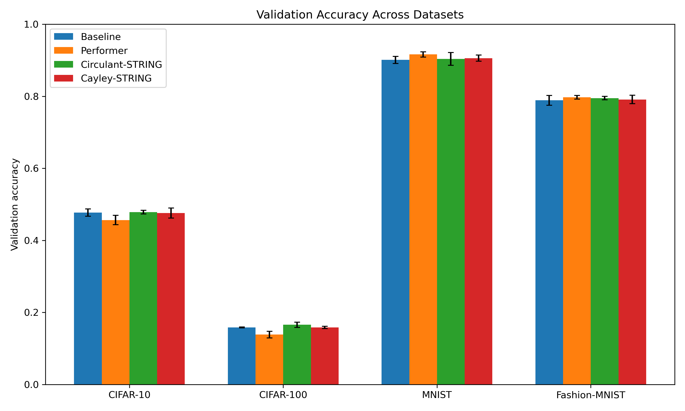
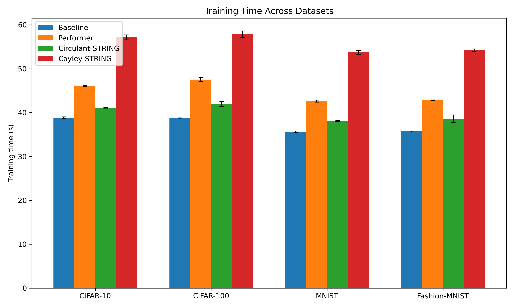

# Efficient Vision Transformer Models

**图像分类中，更“高效”的注意力机制真的更快吗？** 这个课程团队项目在统一的训练和评估流程下，比较标准 Vision Transformer (ViT)、Performer，以及两种受 STRING 启发的结构化位置编码模型。我们在 CIFAR-10、CIFAR-100、MNIST 和 Fashion-MNIST 上测量分类准确率、训练耗时和推理耗时，分析模型效果与计算成本的取舍。

> **快速了解：** 4 个数据集 × 4 种模型 × 3 个随机种子，共 **48 次实验**。在本项目的 32×32 图像、5 轮训练设置下，标准 ViT 训练最快；Circulant-STRING 在 CIFAR-100 上取得最高平均验证准确率 **16.57%**，但训练时间比标准 ViT 略长。

**项目材料：** [完整报告](data_mining_project-report.pdf) · [原始实验数据](results/results.csv) · [模型代码](code/models/) · [团队分工](team_member_contribution.pdf)

## 我的贡献

Xinru Tian 负责实现**标准 ViT 基线模型**，并开发统一的实验流程，包括模型训练、验证评估和跨数据集结果汇总。Performer 与两种 STRING 风格模型由其他团队成员实现；模型比较、代码审查和报告撰写由团队共同完成。具体分工见[团队贡献说明](team_member_contribution.pdf)。

## 实验设计

| 模型 | 比较的机制 |
| --- | --- |
| Baseline ViT | 标准自注意力，作为准确率和耗时的参考 |
| Performer ViT | 基于随机特征近似的注意力 |
| Circulant-STRING ViT | 基于循环相对位移的位置偏置 |
| Cayley-STRING ViT | 基于 Cayley 变换的结构化位置信息 |

所有模型使用相同的图像尺寸、patch 大小、模型宽度、层数和训练计划。每组实验使用 10,000 张训练图像、2,000 张验证图像，训练 5 轮，并用 3 个随机种子重复。两种 STRING 变体是**受相关方法启发的简化实现**，不是原论文的完整复现。

## 主要结果

下表展示每个数据集上平均验证准确率最高的模型，并与标准 ViT 比较。数值是 3 次运行的平均值；训练时间以秒计。

| 数据集 | 准确率最高的模型 | 该模型准确率 | 标准 ViT 准确率 | 该模型训练时间 | 标准 ViT 训练时间 |
| --- | --- | ---: | ---: | ---: | ---: |
| CIFAR-10 | Circulant-STRING | 47.83% | 47.70% | 41.08 s | 38.85 s |
| CIFAR-100 | Circulant-STRING | **16.57%** | 15.82% | 42.00 s | 38.67 s |
| MNIST | Performer | 91.63% | 90.10% | 42.62 s | 35.62 s |
| Fashion-MNIST | Performer | 79.72% | 78.87% | 42.82 s | 35.70 s |

- **速度：** 标准 ViT 在四个数据集上均为训练时间最短的模型。Performer 的注意力计算具有理论上的复杂度优势，但在这组短序列、小规模实验中没有转化为实际速度优势。
- **准确率：** Circulant-STRING 在两个 CIFAR 数据集上取得最高平均准确率；Performer 在 MNIST 和 Fashion-MNIST 上取得最高平均准确率。
- **结论范围：** 结果反映的是当前模型规模、数据子集和训练计划下的比较，不代表这些方法在更大图像或更长序列上的最终表现。





更多图表见 [results/figures/](results/figures/)，完整分析见[项目报告](data_mining_project-report.pdf)。

## 复现方法

依赖：Python、PyTorch、torchvision、NumPy 和 Matplotlib。首次运行会由 torchvision 下载数据集；程序默认自动选择 CUDA、MPS 或 CPU。

```bash
pip install -r requirements.txt
cd code
python main_experiments.py
```

如果只想用仓库中已有的 [`results/results.csv`](results/results.csv) 重新生成汇总和图表，无需重新训练：

```bash
cd code
python main_experiments.py --aggregate-only
```

快速检查运行流程：

```bash
cd code
python main_experiments.py --datasets mnist --models baseline --seeds 0 --epochs 1 --train-size 256 --val-size 128
```

主要代码位于 [`code/main_experiments.py`](code/main_experiments.py)，绘图代码位于 [`code/plot_results.py`](code/plot_results.py)。
